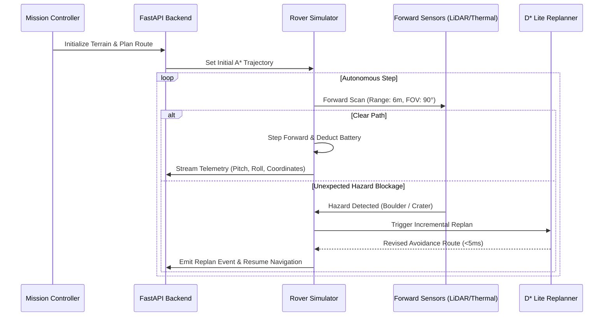

# Lunar Rover AI — AI & Autonomous Workflow

## 1. Autonomous Navigation Pipeline

## 2. Cost Function Formulation
The cost of traversing from grid cell $u$ to adjacent cell $v$ is computed as:

$$C(u, v) = d(u, v) \times \left(1.0 + P_{\text{slope}}(v) + P_{\text{roughness}}(v) + P_{\text{obstacle}}(v)\right)$$

Where:
- $d(u, v)$: Euclidean transition distance ($1.0$ for orthogonal, $\sqrt{2}$ for diagonal).
- $P_{\text{slope}}(v)$: $0$ if $\theta < 14^\circ$, $( \theta - 14^\circ ) \times 8.0$ if $14^\circ \le \theta < 22^\circ$, $\infty$ (impassable) if $\theta \ge 22^\circ$.
- $P_{\text{roughness}}(v)$: Standard deviation of elevation in a $3 \times 3$ window $\times 5.0$.
- $P_{\text{obstacle}}(v)$: $1000.0$ for detected boulders/craters, $40.0$ for safety clearance buffer.

## 3. Engineering Compliance Rules
1. **Algorithm Distinction**: A* and D* Lite are rigorous deterministic path-planning graph algorithms, not statistical machine learning models. They ingest AI-derived terrain cost maps.
2. **Thermal Independence**: Thermal radiation values are simulated independently from elevation and cold-trap physics, not inferred from RGB pixel intensities.
3. **Sensor Alignment**: LiDAR scans, IMU pitch/roll, and coordinate localization are synchronized to the rover's local Cartesian and selenocentric frames.
