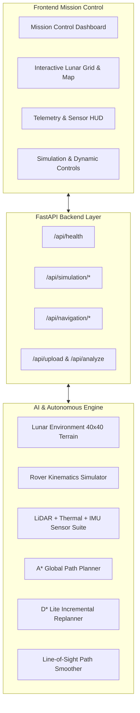

# Lunar Rover AI — System Architecture

## 1. Executive Overview
The **Lunar Rover AI** platform is an autonomous lunar navigation and terrain intelligence system architected for extreme lunar surface environments (such as the South Pole-Aitken Basin). It combines high-resolution orbital reconnaissance with real-time onboard sensory processing, dynamic hazard avoidance, and path-planning algorithms.

## 2. Architectural Layers

### A. Presentation Layer (Frontend)
- **Framework**: Next.js 16 + React 19 + TypeScript + Tailwind CSS v4.
- **Cinematic Visual Language**: Deep space navy `#05070D`, moonlight white `#F4F7FC`, and desaturated atmospheric blue `#84A0C6`.
- **Mission Dashboard**: Real-time interactive 2D lunar terrain grid, live telemetry HUD, waypoint tracking, dynamic obstacle injection, and replanning latency meters.

### B. Application & API Layer (Backend)
- **Framework**: FastAPI (Python 3.13) with Uvicorn.
- **Validation**: Strict Pydantic v2 schemas for all requests and responses.
- **Routing**: Modular endpoints for simulation lifecycle, A* global planning, D* Lite replanning, multi-spectral image analysis, and mission reports.

### C. Simulation & Autonomous Navigation Core
- **Environment**: Synthetic lunar topography incorporating base rolling mare topography, impact craters with parabolic depths and ejecta rims, local gradient slope estimation (deg), and 3x3 roughness metrics.
- **Path Planning**:
  - **A\* Algorithm**: Deterministic grid-based search evaluating transition costs $C(u, v) = \text{dist} \times (1 + \text{slope\_penalty} + \text{roughness} + \text{hazard})$.
  - **D\* Lite Algorithm**: Incremental heuristic search (Koenig & Likhachev) providing sub-5ms replanning when unexpected obstacles appear along the rover's path.
  - **Path Smoother**: Line-of-sight raycasting to eliminate artificial grid stair-stepping.
- **Sensor Suite**: Forward LiDAR (24-point raycast), Thermal Radiometer (Kelvin cold-trap detection), and 3-axis IMU (pitch, roll, yaw).
